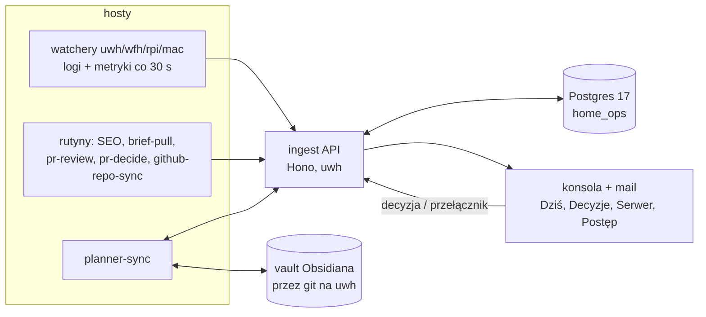

# home-ops — blueprint

Stan opisany: gałąź `dev` (migracje 001–028). Stan w toku (zrobione / czeka na scalenie / wdrożone) żyje w vaulcie (`2-Obszary/homelab/home-ops.md`), nie tutaj. Szczegóły techniczne: `docs/ARCHITECTURE.md`, `CONTEXT.md`, `RUNBOOK.md`, `docs/adr/`.

## Overview

**Cel.** Wspólny backend domowy dla jednego użytkownika (Piotr): logi i metryki hostów, „Dziś” (briefy, karty rutyn, decyzje), skrzynka decyzji z podpisanymi linkami, mail poranny i wieczorny, automatyczny przegląd PR-ów („druga para oczu”), rutyna SEO i lustro vaulta w Postgresie. Repo jest publiczne, więc dokumentacja i kod nie zawierają sekretów ani adresów sieci.

**Granica (decyzja 2026-11-08).** home-ops odpowiada za to, co dzieje się w sieci domowej. Oferty pracy (`job-radar`) mają własną bazę. Nie ma tu Grafany, Lokiego, brokera kolejek ani wielu użytkowników (`adr/2026-06-07-no-grafana.md`).

**Aktorzy.**

| Aktor | Rola |
| --- | --- |
| Piotr | jedyny użytkownik konsoli; odpowiada na decyzje, scala PR-y przez „Dziś” |
| `uwh` | serwer: Postgres, `ingest`, timery i usługi `systemd --user`, runnery GitHub |
| `wfh` | host GPU: Ollama, `gpu-scheduler`, watchery (usługi WinSW) |
| `rpi` | obserwator: Uptime Kuma, Beszel, `rpi-watcher`, `rpi-sentinel` (alarm, gdy `uwh` milczy) |
| `mac` | stacja robocza: vault Obsidiana, sesje Claude, worker w tle |
| `nas` | cel kopii `pg_dump` |
| GitHub | PR-y, Issues, runnery CI, repo `daily-brief` i lustro vaulta |
| agenci Claude (`claude -p`) | `pr-review`, `seo-analyse`, `seo-improve`; zawsze za decyzją albo bez prawa scalania |

**Pętla.** agent na hoście → `POST /api/ingest|metrics|…` (token) → Postgres `home_ops` → `GET /api/today|digest|…` → konsola (vanilla JS + Preact, domyślna zakładka „Dziś”) i mail → decyzja Piotra (przycisk, link) → rutyna odczytuje odpowiedź i działa → karta z wynikiem. Druga pętla: notatka vaulta → git → `planner-sync` → tabela `projects` → konsola → przełącznik zadania → kolejka `task_toggles` → `planner-sync` → commit w vaulcie.

**Legenda maturity** (jedna na cały dokument): `mounted` (działa i jest podpięte) · `nav-hidden` · `built-unmounted` · `unbuilt` (nie zbudowane) · `dormant` · `aspirational`.

## Moduły i przepływy danych

| Moduł | Gdzie | Dane | Maturity |
| --- | --- | --- | --- |
| Ingest logów i metryk | `ingest/src/routes/{ingest,metrics,logs,status,health}.ts` | `host_logs`, `host_metrics` | mounted |
| Watchery hostów | `agents/{elitedesk,rpi,win10}/*-watcher.py`, `agents/_common.py` | wysyłają do `/api/ingest`, `/api/metrics` | mounted |
| Aktywność serwera („Serwer”) | `agents/elitedesk/activity-*.py`, `routes/activity.ts` | `unit_runs`, `activity_now` | mounted |
| Strażnik `rpi-sentinel` | `agents/rpi/rpi-sentinel.py` | alarm mailem z `rpi`, sondy stron `app:<slug>` | mounted |
| Konsola | `ingest/public/*.js` (Preact/htm, vanilla), `routes/auth.ts` | cookie `viewer` albo token | mounted |
| „Dziś”, briefy, kolejka agentów | `routes/{today,briefs,queue}.ts`, `ops/elitedesk/brief-pull.py`, `agents/elitedesk/queue_md.py` | `daily_briefs`, `queue_state` | mounted |
| Digest (mail) i karty rutyn | `routes/{digest,cards}.ts`, `ops/elitedesk/daily-digest.sh`, `render-digest.py`, `agents/routine_report.py` | `digest_cards` | mounted |
| Decyzje i podpisane linki | `routes/decisions.ts`, `decision-links.ts`, `decisions-store.ts`, `mcp/decisions_tools.py` | `decisions` | mounted |
| Przegląd i scalanie PR-ów | `ops/elitedesk/pr_review*.py`, `pr_decide.py`, `pr_gate.py`, `review_db.py` | `pr_reviews`, `decisions` | mounted |
| `planner-sync` (vault ↔ baza) | `agents/elitedesk/planner-sync.py`, `task_ticks.py` | `projects`, `task_toggles`, `board_tasks`, `project_signals` | mounted |
| Synchronizacja GitHub (`github-repo-sync`) | `ops/elitedesk/github-repo-sync.py`, `github_signals.py`, `repo_projects.py` | `projects.repo_meta`, `project_signals` | mounted (wymaga PAT na `uwh`) |
| Postęp | `routes/progress.ts`, `progress-model.ts` | `project_signals` | mounted |
| Rutyna SEO | `ops/elitedesk/seo-*.py`, `seo_*.py`, timery 06:00–06:50, pon. 06:45 | `seo_*` | mounted |
| Kolejka GPU | `routes/jobs.ts`, `scheduler/`, `mcp/server.py` | `gpu_jobs` | dormant |
| Ewaluacja LLM | `ops/llm-eval/`, `routes/{evals,eval-scores}.ts` | `eval_runs`, `eval_scores`, `eval_tasks` | dormant |
| Kopie i retencja | `ops/elitedesk/pg-backup.sh`, `pg_cron` w obrazie `postgres/` | zrzut `pg_dump -Fc` na `nas` | mounted |
| MCP | `mcp/server.py`, `mcp/decisions_tools.py` | narzędzia: logi, joby, karty, decyzje | mounted |
| Mapa ekosystemu, BPMN, presja | — | `/api/map`, `/mapa/` | unbuilt |
| Rejestr miejsc (`storage_places`) | — | lustro `STORAGE.md` | unbuilt |
| Dziennik Maca i sesji Claude | — | `claude_sessions`, `day_journal` | unbuilt |
| Gmail → Postgres | — | schemat `gmail` | unbuilt |
| Worker Maca (agenci Claude w oknach, nadzorca GPU) | — | stan w `~/.local/state` | unbuilt |
| Przepływ `dev` → `test` → `main` | `.github/workflows/` | `check.yml`, `flow.yml` | unbuilt |
| Issues → Now/Next/Later | — | blok `github-issues` w notatkach | unbuilt |
| Strona przeglądu `/review/:id` | — | `decisions.requires_review` | unbuilt |

### Przepływy

1. **Zdarzenie → wiersz.** `journalctl -f` / `docker logs -f` → watcher → paczki co 2 s → `POST /api/ingest` (częściowa akceptacja: zły wiersz trafia do `rejected`, reszta wchodzi) → `host_logs`. Metryki co 30 s z atrybucją procesów w `data` (jsonb). Retencja: `pg_cron` czyści logi starsze niż 30 dni.
2. **Brief → „Dziś”.** Cloud routine commituje `briefs/YYYY-MM-DD-<slot>.md` do repo `daily-brief` → `brief-pull` (timer 15 min, deploy key tylko do odczytu) → `POST /api/briefs` → `daily_briefs` (120 dni) → `GET /api/today`.
3. **Vault → konsola → vault.** `obsidian-git` pushuje vault do repo bare na `uwh` → `planner-sync` ciągnie (`--ff-only`), parsuje frontmatter i sekcje, `POST /api/projects/sync` (upsert + delete-others) → zakładki. Odhaczenie zadania w konsoli kolejkuje wiersz w `task_toggles`; `planner-sync` co 2 s odbiera, zmienia plik, commituje i pushuje. `QUEUE.md` jest lustrzanie kopiowany do `queue_state` (jeden wiersz, `source_hash`).
4. **Rutyna → karta → decyzja.** Rutyna kończy przebieg kartą (`digest_cards`); przed czymś publicznym lub nieodwracalnym zakłada decyzję i kończy. Odpowiedź przychodzi z linku w mailu (GET potwierdza, POST zapisuje), z konsoli albo z API; następny przebieg odbiera ją przez `answers` i oznacza jako `consume`.
5. **PR → scalenie.** `pr-review.timer` (co godzinę 07–23) bierze PR-y, których głowa nie ma wiersza w `pr_reviews`; świeży `claude -p` w trybie tylko do odczytu, dwa przebiegi (znajdź → zweryfikuj), komentarz + etykieta `review:ok|zmiany`. `pr_decide.py` pyta o PR dopiero po przeglądzie jego aktualnego SHA; scalenie z `--match-head-commit`. Autor zmiany nie scala (reguła `branch-hygiene.md`).
6. **Kopia.** `pg-backup.timer` 04:30 → `pg_dump -Fc` → `nas` przez `scp`, 14 dni.

## Kontrakty

**Routine contract** (`adr/2026-10-13-routine-contract.md`).

- Każda rutyna na koniec przebiegu zapisuje jedną kartę: nagłówek, najwyżej 5 pozycji, jedna metryka z kierunkiem. Karta starsza niż `fresh_for` wyświetla się jako „nie uruchomiono”.
- Rutyna prosi o decyzję tylko wtedy, gdy skutek jest publiczny lub nieodwracalny (publikacja, scalenie, wysyłka). Szkice i raporty to same karty.
- Decyzja: pytanie, opcje, `ref`, `parent_id` (drzewo decyzji), wygaśnięcie. Odpowiedź musi być jedną z oferowanych opcji; odrzucenie niesie jednolinijkowy powód. Link w mailu: `/d/<id>/<option>/<exp>/<sig>` (HMAC, wygasa); GET pokazuje potwierdzenie, zapis tylko przez POST.
- Interfejsy: `python3 -m agents.routine_report card|ask|answers|consume`, klasa `Reporter`, narzędzia MCP `post_digest_card`, `create_decision`, `list_decisions`, `consume_decision`.

**Kontrakt briefu** (`adr/2026-10-17-daily-briefs.md`). Plik `briefs/YYYY-MM-DD-<slot>.md`; frontmatter `date`, `slot` (`morning|evening`), `generated_at`, `title`, `sources`; data i slot zgodne z nazwą pliku; treść ≤ 20 000 znaków, renderowany podzbiór markdowna (`md-lite.js`: najpierw escape, potem stały zestaw wzorców). Upsert po `(brief_date, slot)`.

**Stan kolejki agentów** (`adr/2026-10-20-queue-state.md`).

- Vault (`QUEUE.md`) jest źródłem prawdy; home-ops tylko lustrzuje i niczego nie zapisuje z powrotem.
- Jeden parser (`queue_md.py`): nagłówek okna, pięć sekcji, bilety z klasą (`risk|money|focus|clean|idea`), rozmiarem `S|M|L|XL`, flagami (`unblocks`, `local`, `paused`, `experiment`), `[[projekt]]`, `ID-n`, modelem `plan → exec`, czasem. Nierozpoznana linia zostaje jako tekst, nic nie jest gubione.
- Jeden wiersz `queue_state` (`id = 1`; `sections`, `summary` jako jsonb); `POST /api/queue/sync` (token) z krótkim obiegiem po `source_hash`; `GET /api/queue` (viewer); `GET /api/today` niesie `queue`. Brak `QUEUE.md` jest po cichu pomijany, karta zostaje ukryta.

**Auth.** Maszyny: nagłówek `X-Ingest-Token`. Konsola: cookie po `LOGS_PASSWORD`. Linki z maila: HMAC z `DECISION_SECRET`. Postgres nasłuchuje tylko na loopbacku; konsola działa po HTTP w LAN i tailnecie, bez ekspozycji publicznej.

**Migracje.** Pliki `postgres/migrations/NNN_*.sql`, idempotentne (`IF NOT EXISTS`, `CREATE OR REPLACE`); `scripts/apply-migrations.sh` stosuje je leksykalnie w transakcji i zapisuje `(nazwa, suma kontrolna)` w `schema_migrations`. Luka w numeracji 024–025 jest znana.

**Wdrożenie agentów.** `scripts/deploy-agent.sh <host> <agent>` kopiuje plik agenta i moduły `agents/<host>/*_*.py` do `~/bin/`; nazwa modułu pomocniczego musi więc zawierać `_`. Jednostki systemd w `ops/elitedesk/` są dowiązane (nie kopiowane) do `~/.config/systemd/user/`.

## Środowiska i bazy

Docelowy model (reguła „trzy gałęzie”, `branch-hygiene.md`): `dev` → `test` → `main`; każda gałąź ma własną bazę na `uwh`, a Mac nie trzyma bazy na stałe.

| Gałąź | Baza `home-ops` | Stan w repo na `dev` |
| --- | --- | --- |
| `main` | `home_ops` — produkcja, `uwh`, kontener Postgresa na serwerze | jedyna istniejąca baza |
| `test` | `home_ops_test` (zanonimizowana kopia) | brak: nie ma jeszcze reguł anonimizacji ani odświeżania (HO-G37) |
| `dev` | `home_ops_dev` (dane testowe) | brak; testy integracyjne CI używają jednorazowego `postgres:17-alpine` |

- Wdrożenie: `git pull` w katalogu repo na serwerze, `scripts/apply-migrations.sh`, `docker compose up -d --build ingest`, odświeżenie agentów `deploy-agent.sh`. Jednostki uruchamiają kod prosto z checkoutu.
- Agenci hostów działają z kopii w `~/bin/` (Linux) albo jako usługi WinSW (`wfh`); `git pull` ich nie aktualizuje.
- CI (`.github/workflows/check.yml`): typecheck + biome, kompilacja Pythona z ręcznej listy plików, shellcheck, `docker compose build`, Vitest, unittest, testy integracyjne na prawdziwym Postgresie, skan sekretów.
- Produkcja Strummy współdzieli `uwh`: nic w tym repo nie zatrzymuje ani nie restartuje kontenerów produkcji Strummy.

## Luki

ID są stałe i nie są renumerowane; krótki opis, kierunek i kryterium akceptacji. Źródła: **BEZP** = `analysis/2026-11-15-home-ops-bezpieczenstwo.md` (znaleziska `S<n>`), **DŁUG** = `analysis/2026-11-15-home-ops-testy-dlug.md` (`P<n>` ścieżki, `D<n>` dług, `zad.<n>` zadania), **PODZ** = `analysis/2026-11-16-home-ops-planner-sync-podzial.md`, **VAULT** = `2-Obszary/homelab/home-ops.md`.

### Bezpieczeństwo i scalanie

Szczegóły luk bezpieczeństwa (opis, kierunek, akceptacja) są w prywatnym vaulcie (`BEZP`); tu zostają tylko ID i tytuły.

| ID | Temat | Brief |
| --- | --- | --- |
| HO-G01 | izolacja recenzenta PR-ów | brief: vault BEZP S1 |
| HO-G02 | bramka scalania PR-ów i zakres CI | brief: vault BEZP S2 |
| HO-G03 | przegląd automatycznych PR-ów SEO | brief: vault BEZP S3 |
| HO-G04 | autoryzacja odpowiedzi na decyzje | brief: vault BEZP S4 |
| HO-G05 | walidacja zadań w kolejce GPU | brief: vault BEZP S5 |
| HO-G06 | logowanie do konsoli i sesje | brief: vault BEZP S6, S14, S17 |
| HO-G07 | tryb publiczny konsoli | brief: vault BEZP S7 |
| HO-G08 | aktualizacja zależności serwera HTTP | brief: vault BEZP S8 |
| HO-G09 | podział ról bazy danych | brief: vault BEZP S9 |
| HO-G10 | odporność zapisów do vaulta | brief: vault BEZP S10; PODZ B2/B3 |
| HO-G11 | zakres baz objętych `pr-decide` | brief: vault BEZP S11 |
| HO-G12 | ochrona gałęzi `dev`/`test`/`main` | brief: vault BEZP S12 |
| HO-G13 | zakres logów zbieranych z kontenerów | brief: vault BEZP S13 |
| HO-G14 | gałąź checkoutu na serwerze | brief: vault BEZP S15 |
| HO-G15 | kopie zapasowe bazy | brief: vault BEZP S16 |
| HO-G16 | walidacja parametrów zapytań | brief: vault BEZP S18; DŁUG D3 |
| HO-G17 | hardening jednostek systemd | brief: vault BEZP S19 |
| HO-G18 | porządek w danych środowiska w publicznym repo | brief: vault BEZP S20 |
| HO-G19 | polityka tokenów | brief: vault BEZP, sekcja „Czeka na Piotra” |

### Testy i dług

| ID | Luka → kierunek | Akceptacja | Źródło |
| --- | --- | --- | --- |
| HO-G20 | Walidacja paczek `/api/ingest` i `/api/metrics` bez testów i zduplikowana. Moduł `ingest-validate.ts` | ≥ 12 przypadków; w trasach brak definicji walidatora | DŁUG P1, P2, D4, zad.1 |
| HO-G21 | `IngestClient` (`agents/_common.py`) bez testów; pięć własnych klientów HTTP z tokenem. Testy z atrapami `urlopen`/`sleep`, potem jeden klient | ≥ 9 testów | DŁUG D2, zad.2 |
| HO-G22 | `level_from_priority` skopiowane w watcherach `uwh` i `rpi` i już się rozjechało (priorytet 2: `error` vs `fatal`); wspólny kod watcherów (`shipper`, `follow_docker_container`). Jedna funkcja w `_common.py` | `grep "def level_from_priority"` zwraca tylko `_common.py` | DŁUG D1, zad.3 |
| HO-G23 | Brak testu spójności jednostek: `.timer` bez `.service`, `ExecStart` na nieistniejący plik, `OnFailure` na nieistniejący unit | test czerwony po zmianie nazwy `pr_decide.py` | DŁUG P10, P11, zad.4 |
| HO-G24 | Runner workera Maca (`claude_run.py`, `runner.accept_for`, `LIMIT_RE`) bez testów | ≥ 7 testów | DŁUG P14, zad.5 |
| HO-G25 | Trasy przełączników zadań (`task_toggles`, `/mark`) bez testów | ≥ 10 przypadków, plik w jobie `tests-state-machine` | DŁUG P5, zad.6 |
| HO-G26 | Trasy tablicy (`board.ts`, 233 linie) bez testów | ≥ 12 przypadków | DŁUG P5, zad.7 |
| HO-G27 | `planner-sync.py` (732 linie, 4 role w jednym pliku). Test charakteryzujący całego ticka, potem podział na moduły < 150 linii (`vault_write`, `toggles_sync`, `board_md`, `board_sync`, …) po dodaniu modułów oznaczonych `unbuilt` | testy bez zmian; każdy moduł < 150 linii | PODZ; DŁUG zad.8 |
| HO-G28 | `mcp/server.py` (521 linii): narzędzia eval do `eval_tools.py` jak `decisions_tools.py` | `server.py` < 380 linii; ta sama liczba `@mcp.tool` | DŁUG zad.9 |
| HO-G29 | CI kompiluje Pythona z ręcznej listy 33 plików (18 poza nią). `compileall` na `agents scheduler clients ops mcp` | job `python` zielony | DŁUG D6, zad.10 |
| HO-G30 | CI stosuje tylko 14 z 26 migracji (brak `pg_cron`). Job z obrazem z `postgres/Dockerfile` i `apply-migrations.sh` dwa razy na pustej bazie; test samego runnera | wszystkie migracje przechodzą dwa razy | DŁUG P12 |
| HO-G31 | `GET /api/digest` bez testu (werdykt, grupowanie problemów, karty nieaktualne), `send-digest.py` bez testu | test trasy i nadawcy | DŁUG P7 |
| HO-G32 | Decyzje i strona „Dziś”: `normalizeOptions`, escapowanie w `decision-pages.ts`, front `today-*.js` bez testów | testy czystych funkcji | DŁUG P6, P8 |
| HO-G33 | `gpu-scheduler.py` (390 linii) bez testów; los toru GPU i LLM-eval (zostają trasy, zakładki, 5 narzędzi MCP, a `report.py` żyje tylko na serwerze). Testy `runner_loop` i `detector_loop`; decyzja: utrzymać czy usunąć | decyzja zapisana w ADR | DŁUG P13, D9 |
| HO-G34 | Martwy lub nieaktualny front i pliki: `index-shell.html`/`shell.js`, wariant `status.js`, `mockups/`, `data.js` z danymi z czerwca, `clients/node` i `clients/python` bez użytkowników, `tasks/todo.md`, `vault-ticks-backfill.py`; README i `ROADMAP.md` nieaktualne (dublują vault) | usunięte albo uzasadnione; README zgodne ze stanem | DŁUG D7, D8, D10, D11; VAULT |
| HO-G35 | Pliki ponad limit 150/200 linii (m.in. `rpi-sentinel.py`, `routes/projects.ts`, `github-repo-sync.py`, `board.ts`, `chat.js`, `app.js`, `styles.css`) i funkcje > 50 linii | podział przy okazji zmian, bez zmiany zachowania | DŁUG §2 |

### Funkcje i operacje

| ID | Luka → kierunek | Akceptacja | Źródło |
| --- | --- | --- | --- |
| HO-G36 | Brak tabeli `agent_runs` (bilet, model, czas, tokeny, koszt, wynik) i widoku „koszt na zaakceptowany bilet”; zapisy z hooka `SessionEnd`, GPU scheduler i timerów `claude -p` | koszt i czas per model i bilet w konsoli | VAULT Next; `analysis/2026-10-19-agent-queue-design.md` §9 |
| HO-G37 | Baza `home_ops_test` i `home_ops_dev` oraz anonimizacja kopii produkcji (każda kolumna sklasyfikowana, test CI na kolumnę bez reguły) | test CI; `test` odświeżana co tydzień | reguła trzech gałęzi i baz per gałąź (vault, `rules/branch-hygiene.md`) |
| HO-G38 | `github-repo-sync.timer` nie wdrożony (PAT), brak heatmapy 12 tygodni i flagi „gorący, ale stoi” w Postępie | timer aktywny; widok w „Postęp” | VAULT Later |
| HO-G39 | `pr-agent` nie zainstalowany: „Popraw” tylko nadaje etykietę `fix-requested` | `pr-agent` naprawia PR po etykiecie | VAULT |
| HO-G40 | Tor lokalny `draft_pr` w `gpu_jobs`: bilet → Ollama → gałąź → bramki na runnerze → karta do przeglądu | 3 bilety przeszły ścieżkę | VAULT Later |
| HO-G41 | Import danych marketingowych: brak schematu `marketing`, importera i timera po `seo-collect` | import z klonu vaulta + wpis w rejestrze miejsc | VAULT Next |
| HO-G42 | Uptime Kuma nie rozwiązuje nazwy tailnetowej `uwh`; zakres alarmów `OnFailure=` | monitor zielony, wpis nie jest wyciszony | VAULT Next, Later |
| HO-G43 | Wdrożenie przez `ssh` + `docker compose` i ręczne kopiowanie agentów; brak roli Ansible (compose, agent per host, unity, timer kopii) | świeży host odtworzony jednym poleceniem | VAULT Later; `README.md` |
| HO-G44 | Frontend konsoli: dokończyć albo porzucić migrację zakładek na Preact (6 pozostałych) i widok Hosts (401 przy `/login`, stopka z danych-atrap) | decyzja + usunięcie wariantu A/B | VAULT Later; DŁUG D7 |

## Test plan

- **Bramki lokalne** (`ingest/`): `npm ci && npm run check` (tsc + biome), `npx vitest run`; Python: `python3 -m unittest discover -s agents/tests -p 'test_*.py'` i `-s ops/elitedesk/tests`. Testy integracyjne wymagają `DATABASE_URL` (bez niej są pomijane): jednorazowy kontener `postgres:17-alpine` z migracjami, jak w CI.
- **Warstwy.** Czyste funkcje (`*-pure.js`, `*-model.ts`, parsery) — testy jednostkowe; trasy ze stanem — integracyjne na prawdziwym Postgresie; ręczne raporty HTML w `docs/manual-tests/` dla większych zmian; E2E nie ma i nie jest potrzebne (jeden użytkownik).
- **Luki w pokryciu** są w sekcji „Testy i dług” (HO-G20…G35). Kryteria akceptacji testów bezpieczeństwa (HO-G01…G07) są w vaulcie.
- **Smoke po wdrożeniu na `uwh`:** `/api/health` → `ok`, `docker compose ps` — `ingest` i `postgres` zdrowe, brak zmian w kontenerach produkcji Strummy.

## Open questions

- Polityka tokenów (jeden vs per host; HO-G19).
- Los toru GPU i LLM-eval (HO-G33): utrzymać czy usunąć.
- `data.js` w konsoli: wartości zastępcze czy coś nadal pokazuje dane z czerwca (HO-G34).

## References

- ADR: `docs/adr/2026-06-07-no-grafana.md`, `2026-10-13-routine-contract.md`, `2026-10-17-daily-briefs.md`, `2026-10-20-queue-state.md`
- Dokumenty: `docs/ARCHITECTURE.md`, `docs/CONTEXT.md`, `docs/RUNBOOK.md`, `ops/elitedesk/README.md`
- Vault: `2-Obszary/homelab/home-ops.md`; analizy `3-Zasoby/analysis/2026-11-15-home-ops-bezpieczenstwo.md`, `2026-11-15-home-ops-testy-dlug.md`, `2026-11-16-home-ops-planner-sync-podzial.md`
- Raporty ręcznych testów: `docs/manual-tests/`
